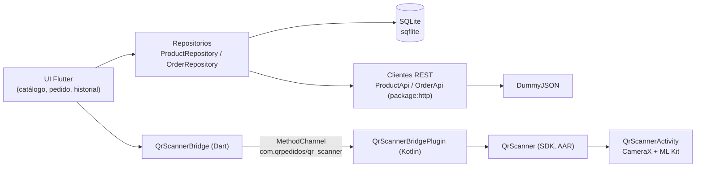

# QR Pedidos — SDK Android de lectura QR, puente Flutter y app de pedidos offline

Entrega del examen técnico **Mobile Software Engineer — Devel Systems**. La app Flutter descarga un catálogo de DummyJSON y lo guarda en SQLite; lee QR de productos (`product:<id>`) mediante un **SDK nativo propio en Kotlin** (CameraX + ML Kit, empaquetado como AAR) integrado a través de un **puente Flutter propio** (`MethodChannel`); permite crear pedidos sin conexión y los envía de forma manual con una cola que evita duplicados locales y distingue el resultado desconocido. Plataforma: Android (sin bono iOS).

## Enlaces de entrega

| Elemento | Enlace |
| --- | --- |
| Repositorio | https://github.com/KassieBarrera/qr-pedidos |
| Tag de entrega | `v1.0.0` |
| GitHub Release | [https://github.com/KassieBarrera/qr-pedidos/releases/tag/v1.0.0](https://github.com/KassieBarrera/qr-pedidos/releases/tag/v1.0.0) |
| AAR (`qrscanner-release.aar`) | [Descargar AAR](https://github.com/KassieBarrera/qr-pedidos/releases/download/v1.0.0/qrscanner-release.aar) |
| APK debug (`app-debug.apk`) | [Descargar APK](https://github.com/KassieBarrera/qr-pedidos/releases/download/v1.0.0/app-debug.apk) |
| Video de demostración | [https://www.youtube.com/watch?v=r9FU7QaYnqk](https://www.youtube.com/watch?v=r9FU7QaYnqk) (2:47, vertical; público, no requiere iniciar sesión) |
| Declaración de IA | [`AI_USAGE.md`](AI_USAGE.md) |

## Contenido

1. [Estructura del repositorio](#1-estructura-del-repositorio)
2. [Arquitectura](#2-arquitectura)
3. [Contrato del SDK y del puente](#3-contrato-del-sdk-y-del-puente)
4. [Formato QR y decisiones](#4-formato-qr-y-decisiones)
5. [Persistencia](#5-persistencia)
6. [Estados del pedido y cola de envío](#6-estados-del-pedido-y-cola-de-envío)
7. [Estrategia de errores](#7-estrategia-de-errores)
8. [Qué haría falta en una API real](#8-qué-haría-falta-en-una-api-real)
9. [Decisiones adicionales](#9-decisiones-adicionales)
10. [Dependencias](#10-dependencias)
11. [Herramientas y versiones](#11-herramientas-y-versiones)
12. [Instalación, compilación y ejecución](#12-instalación-compilación-y-ejecución)
13. [Pruebas](#13-pruebas)
14. [QR de prueba](#14-qr-de-prueba)
15. [Reproducir el flujo offline](#15-reproducir-el-flujo-offline)
16. [Dispositivos probados](#16-dispositivos-probados)
17. [Implementado, probado y pendiente](#17-implementado-probado-y-pendiente)
18. [Tiempo aproximado y uso de IA](#18-tiempo-aproximado-y-uso-de-ia)
19. [Limitaciones conocidas](#19-limitaciones-conocidas)

## 1. Estructura del repositorio

Los tres componentes están separados y se compilan por su cuenta.

```
android_sdk/          SDK Android (Kotlin, módulo Android Library -> AAR). No depende de Flutter
qr_scanner_bridge/    Plugin Flutter local (MethodChannel + API Dart tipada)
app_flutter/          App Flutter (UI, REST, SQLite, pedidos, cola de envío)
docs/                 Contrato del escáner, matriz de pruebas, logs
PROGRESO.md           Estado y bitácora del trabajo
```

| Componente | Responsabilidad (sección 3 del enunciado) | Dónde |
| --- | --- | --- |
| SDK Android en Kotlin | Cámara, permiso de cámara, ciclo de vida, lectura y validación del QR, resultado, errores, cancelación y un único resultado por sesión | [`android_sdk/`](android_sdk/README.md) |
| Puente Flutter propio | Contrato Dart, comunicación con el SDK, conversión de tipos, propagación de resultados y errores | [`qr_scanner_bridge/`](qr_scanner_bridge/README.md) |
| Aplicación Flutter | Interfaz, REST, catálogo, base de datos, pedidos y cola de envío | [`app_flutter/`](app_flutter/) |

Documentación complementaria: [`docs/CONTRATO_SCANNER.md`](docs/CONTRATO_SCANNER.md) · [`docs/MATRIZ_PRUEBAS.md`](docs/MATRIZ_PRUEBAS.md) · [`docs/LOGS.md`](docs/LOGS.md) · [`app_flutter/docs/MODO_SIMULADO.md`](app_flutter/docs/MODO_SIMULADO.md) · [`PROGRESO.md`](PROGRESO.md).

Estructura de `app_flutter/lib/`:

| Carpeta | Contenido |
| --- | --- |
| `core/config`, `core/database`, `core/network`, `core/logging`, `core/theme`, `core/widgets` | Configuración (`API_MODE`), SQLite (`AppDatabase`), clientes REST y errores, logger, tema, widgets compartidos; `core/format.dart` da formato al dinero |
| `core/network/fake/` | Cliente HTTP simulado para el modo simulado |
| `data/models`, `data/repositories` | `Product`, `Order`, `OrderLine`, `OrderStatus`; `ProductRepository` y `OrderRepository` (cola) |
| `features/catalog`, `features/order`, `features/history` | Catálogo y escaneo, pedido actual (`CartController`), historial y envío (`OrdersController`) |
| `features/home_shell.dart` | Navegación entre las tres vistas |

## 2. Arquitectura



- El SDK no conoce Flutter, pedidos ni REST. El puente solo traduce tipos y errores. Flutter decide si el producto existe.
- Estado en la UI: `ChangeNotifier` + `ListenableBuilder`, sin paquetes externos de estado (`CartController`, `OrdersController`).
- La base local alimenta la interfaz; la red solo refresca la copia local.

## 3. Contrato del SDK y del puente

Fuente única de verdad: [`docs/CONTRATO_SCANNER.md`](docs/CONTRATO_SCANNER.md).

**API pública del SDK** (`com.qrpedidos.sdk`): `QrScanner.startScan(context, callback)`, `QrScanner.cancelScan(): Boolean`, `QrScanner.isScanning`, `QrScanner.setLoggingEnabled(...)`, `QrValidator.validate(...)`, `ScanResult` (`Success(productId: Long)` / `Failure(error, message)`) y `ScanErrorCode`. `QrScannerActivity` y `ScanSessionManager` son internos.

**MethodChannel `com.qrpedidos/qr_scanner`:** `scanProduct` devuelve `{"productId": <int>}` o un `PlatformException` con el código; `cancelScan` devuelve `bool`. **API Dart:** `QrScannerBridge.scanProduct()` (lanza `ScanException`) y `cancelScan()`.

**Códigos estables:**

| Código | Cuándo |
| --- | --- |
| `permissionDenied` | El usuario rechazó el permiso de cámara |
| `cameraUnavailable` | Sin cámara o no se pudo abrir/vincular |
| `invalidQr` | QR que no cumple `^product:[1-9][0-9]*$` o no cabe en `Long` |
| `cancelled` | Atrás, botón Cancelar, `cancelScan()`, segundo plano, o desconexión de la actividad/motor Flutter |
| `scanInProgress` | Se pidió un escaneo con otro activo (lo recibe el nuevo llamador) |

En Dart se añade `unknown` (código no reconocido, `MissingPluginException` o `productId` ausente o no positivo).

**Decisiones:**

| Tema | Decisión |
| --- | --- |
| Cancelación | **Error tipado** `cancelled` en todo el recorrido (SDK, puente y Dart); nunca `null` |
| QR inválido | **Terminal**: la sesión termina al primer QR con formato inválido; no se devuelve el texto leído |
| Un resultado por sesión | Exactamente uno; lecturas o cancelaciones posteriores se ignoran. Entrega siempre en el hilo principal |
| Segundo plano (`onStop`) | **Cancela** la sesión con `cancelled`; no se restaura. Excepción: no cancela mientras está abierto el diálogo de permiso del sistema (la actividad puede quedar detenida y se perdería la sesión antes de que el usuario responda); si el sistema destruye la actividad con el diálogo abierto, `onDestroy` cancela |
| Rotación | La actividad declara `configChanges` y **no se recrea**; la cámara sigue |
| Muerte del proceso | Si la actividad se recrea sin sesión activa con su id, hace `finish()` sin entregar nada |
| Desconexión de actividad o motor Flutter | El plugin cancela la sesión y responde `cancelled`; ninguna llamada queda pendiente |
| Llamadas concurrentes | La segunda recibe `scanInProgress` sin alterar la primera (en Dart ni llega al canal) |
| Recursos | Se liberan una sola vez al terminar: `unbindAll()`, cierre del detector y del executor |

**MethodChannel frente a Pigeon.** El contrato son 2 métodos sin argumentos, un mapa `{productId}` y 5 códigos de error. Pigeon añadiría generación de código y un paso de build sin aportar seguridad real a un contrato tan pequeño; conviene con más métodos o tipos complejos. La tipificación se hace en la capa Dart (`ScanErrorCode`, `ScanException`) y se verifica con pruebas.

La integración del puente con otra app Flutter exige declarar `:qrscanner` en `settings.gradle(.kts)`; está explicada en [`qr_scanner_bridge/README.md`](qr_scanner_bridge/README.md). La integración del SDK en una app Android nativa está en [`android_sdk/README.md`](android_sdk/README.md). No se usan plugins Flutter de cámara, QR ni permisos: el permiso de cámara lo solicita la propia pantalla del SDK.

## 4. Formato QR y decisiones

Contenido del QR: `product:<id>` con prefijo exacto en minúsculas e ID entero positivo sin signo, espacios ni ceros iniciales.

| Caso | Dónde se resuelve | Resultado |
| --- | --- | --- |
| Formato inválido o número fuera de `Long` | SDK (`QrValidator`) | `invalidQr` |
| Producto guardado localmente | Flutter, base local | Se agrega al pedido |
| No está local y hay red | Flutter, `GET /products/{id}` | Se agrega si existe |
| `product:999999` (formato válido, HTTP 404) | Flutter | Mensaje de producto no encontrado; no se agrega ninguna línea |
| No está local y no hay conexión | Flutter | Mensaje "no disponible offline" |
| Error del servidor (por ejemplo HTTP 500) | Flutter | Falla del servidor, **distinta** de "sin conexión" |
| Cancelado o permiso rechazado | Puente | Mensaje neutro o de permiso, sin agregar nada |

**Re-escanear el mismo producto en una nueva sesión suma 1 unidad** a su línea (`CartController.addProduct`). La cantidad se ajusta con el mismo contador − n + en el **catálogo** (aparece en la fila en cuanto el producto está en el pedido) y en **Pedido actual**; bajar a 0 quita la línea.

## 5. Persistencia

**Por qué SQLite (`sqflite`).** Los pedidos y sus líneas son datos relacionales que deben guardarse de forma atómica, consultarse por estado y sobrevivir al cierre de la app. SQLite aporta transacciones, claves foráneas y restricciones (`CHECK`) que SharedPreferences o un JSON no dan, y es la opción estándar en Flutter sin dependencias exóticas. Las pruebas usan `sqflite_common_ffi` con una base en memoria.

Esquema (versión 2, `AppDatabase`):

| Tabla | Columnas |
| --- | --- |
| `products` | `id` (PK), `title`, `price`, `updated_at` |
| `orders` | `id` (UUID v4 local, PK), `status`, `created_at`, `updated_at`, `attempts`, `last_error`, `remote_ref` |
| `order_lines` | `order_id` (FK a `orders`, `ON DELETE CASCADE`), `product_id`, `quantity` (`CHECK quantity > 0`), `title`, `unit_price`; PK `(order_id, product_id)` |

- `PRAGMA foreign_keys = ON` al abrir.
- Pedido y líneas se insertan en **una sola transacción**: no hay pedidos con líneas incompletas. Las líneas copian nombre y precio al guardar.
- **Migración v1 a v2:** `onUpgrade` crea `orders` y `order_lines` si la versión anterior era menor que 2; `products` se conserva.
- Refrescar el catálogo reemplaza productos (`REPLACE`) y **no toca pedidos**. Si la descarga falla, se conserva la última copia válida.
- El **carrito sin guardar vive en memoria** y no sobrevive al cierre (lo permite el enunciado); los pedidos guardados sí.
- La apertura de la base se comparte entre llamadas concurrentes y, si falla, se reintenta en el siguiente acceso.

**Total estimado y redondeo.** Suma de `precio × cantidad`, sin impuestos, descuentos ni envío; se identifica como estimado en la UI. El cálculo usa el valor completo (`double`) y **solo se redondea a 2 decimales al mostrarlo** con `toStringAsFixed(2)` (`core/format.dart`). Los pedidos guardan el precio unitario sin redondear.

## 6. Estados del pedido y cola de envío

| Estado (código) | Etiqueta en la UI | Significado |
| --- | --- | --- |
| `pending` | Pendiente | Guardado y disponible para enviar |
| `sending` | Enviando | Intento activo; no se permite otro envío del mismo pedido |
| `confirmed` | Confirmado simulado | HTTP 2xx con JSON válido y `id` numérico; excluido de próximos envíos |
| `error` | Error | Fallo conocido (4xx/5xx, JSON inválido, respuesta sin `id`, sin conexión antes de enviar); reintentable |
| `unknown` | Resultado desconocido | No se sabe si el intento llegó al servidor (timeout, conexión cortada, cierre de la app durante el envío) |

Transiciones (todas conservan el mismo ID local):

| Desde | Hacia | Evento |
| --- | --- | --- |
| (nuevo) | `pending` | Guardar pedido |
| `pending`, `error` | `sending` | **Enviar pendientes** (lote) o reintento individual |
| `unknown` | `sending` | Solo reintento manual individual, con diálogo de advertencia |
| `sending` | `confirmed` | Respuesta satisfactoria y válida |
| `sending` | `error` | Fallo conocido |
| `sending` | `unknown` | Timeout, conexión cortada o error inesperado |
| `sending` (al iniciar la app) | `unknown` | `recoverInterruptedSends`: la app se cerró durante el envío |

**Prevención de duplicados (doble toque):**

1. El botón se deshabilita mientras hay un lote activo (muestra "Enviando…") y se oculta cuando no hay pedidos Pendientes ni con Error.
2. `OrderRepository.sendPending` comparte el lote en curso: una segunda llamada se une al mismo `Future` y no inicia otro lote ni otro POST.
3. `claimForSending` hace un `UPDATE ... WHERE status IN (...)` atómico en SQLite y suma el intento; si otro intento ya tomó el pedido, no se envía. Además un conjunto en memoria evita enviar dos veces el mismo pedido a la vez.

Los pedidos `confirmed` nunca se reenvían. Los `unknown` **no entran en el envío masivo**: se reintentan uno a uno, tras una advertencia de que el servidor pudo haberlo recibido ya. Cada pedido guarda `attempts`, `last_error` y `remote_ref` (la referencia de DummyJSON es solo de demostración y no es la identidad del pedido).

## 7. Estrategia de errores

Timeout de **10 s** por solicitud (`guardedRequest`, en `core/network/api_exceptions.dart`). La app muestra el resultado por pedido y permite seguir con los datos locales.

| Causa | Clasificación | Estado del pedido / efecto |
| --- | --- | --- |
| Sin conexión antes de enviar (fallo DNS, conexión rechazada, red inalcanzable) | La solicitud no salió | `error` ("Sin conexión. La solicitud no se envió."), reintentable |
| Timeout | `outcomeUnknown` | `unknown` ("El servidor no respondió a tiempo.") |
| Conexión cortada durante el intercambio | `outcomeUnknown` | `unknown` ("Se perdió la conexión durante el envío.") |
| HTTP no 2xx (4xx/5xx) | Rechazo del servidor | `error` con el código HTTP |
| HTTP 2xx con JSON inválido | Respuesta inválida | `error` |
| HTTP 2xx sin `id` numérico | Respuesta inválida | `error` |
| Error inesperado en el envío | No se sabe si salió | `unknown` |
| App cerrada con el pedido en `sending` | Intento interrumpido | `unknown` al iniciar |

Catálogo: ante cualquier fallo se conserva la copia local. Solo un fallo de conectividad se muestra como "sin conexión"; un HTTP 500 o un JSON inválido se muestran como fallo del servidor.

## 8. Qué haría falta en una API real

DummyJSON es simulado: `POST /carts/add` no persiste nada y no ofrece idempotencia, por lo que esta entrega **no promete procesamiento remoto exactamente una vez**. Para garantías más fuertes se necesitaría:

- **Clave de idempotencia reconocida por el servidor.** El ID local estable (UUID) se enviaría como `Idempotency-Key` o campo equivalente, y el servidor devolvería el mismo resultado ante repeticiones sin crear duplicados.
- **Consulta de estado.** Un `GET` por la clave o por el ID del pedido permitiría resolver un `unknown` (timeout o conexión cortada) sin reintentar a ciegas.
- **Identidad estable del pedido en el servidor**, distinta de una referencia efímera.
- **Contrato de errores** que distinga rechazos definitivos de transitorios (por ejemplo `409`/`422` frente a `503`).
- Con eso, el reintento de un `unknown` sería seguro y podría automatizarse; hoy es manual y con advertencia.

## 9. Decisiones adicionales

- **Stock no usado.** DummyJSON devuelve `stock` en cada producto, pero la app lo ignora a propósito: la sección 5 del enunciado dice que bastan `id`, `title` y `price`; la sección 12 excluye la gestión real de inventario; y `POST /carts/add` es simulado, así que el stock nunca se descontaría y mostrarlo sería engañoso (`Product.fromJson` solo lee `id`, `title` y `price`).
- **Modo simulado** (`--dart-define=API_MODE=fake`): sustituye solo el transporte HTTP por un cliente falso con fixtures y escenarios de fallo (sin conexión, HTTP 500/400, JSON inválido, timeout, conexión cortada); `ProductApi` y `OrderApi` reales no cambian. Una franja visible indica cuándo está activo. El APK de entrega se compila sin esa opción y usa el servicio real. Detalle en [`app_flutter/docs/MODO_SIMULADO.md`](app_flutter/docs/MODO_SIMULADO.md).
- **Logs de diagnóstico:** Logcat (`QrSdk`, `QrBridge`) y Dart (`[qr_pedidos/<area>]`), con formato `evento clave=valor`, correlación por sesión, pedido y lote, sin datos personales ni QR completo. Ver [`docs/LOGS.md`](docs/LOGS.md), con trazas reales del emulador.
- **Diseño "Mostrador"** (`core/theme/app_theme.dart`): tinta `#1F2A44`, ámbar `#F2A33A` (acción de escaneo) y papel `#FAF7F2`; tema claro y oscuro; solo fuente del sistema (funciona offline). Los estados se comunican con **icono + texto** y no solo con color; áreas táctiles de 48 dp; la bitácora registra contraste ≥ 4.5:1 verificado en el emulador. Tres vistas: Catálogo, Pedido actual e Historial, con estados de carga, vacío, error y sin conexión.
- **Cliente HTTP:** `package:http`, con un decorador de logs (`LoggingClient`) que envuelve al cliente real o simulado.

## 10. Dependencias

### AAR (`android_sdk/qrscanner/build.gradle.kts`)

| Dependencia | Versión | Licencia |
| --- | --- | --- |
| CameraX (`camera-core`, `camera-camera2`, `camera-lifecycle`, `camera-view`) | 1.4.2 | Apache 2.0 |
| ML Kit `com.google.mlkit:barcode-scanning` | 17.3.0 | Términos de ML Kit de Google; modelo **empaquetado** en la app, sin descarga en tiempo de ejecución (funciona sin conexión) |
| `androidx.activity:activity-ktx` | 1.9.3 | Apache 2.0 |
| `androidx.core:core-ktx` | 1.15.0 | Apache 2.0 |
| `junit:junit` (solo pruebas) | 4.13.2 | EPL 1.0 |

`minSdk 24`, `compileSdk 36`, Kotlin/JVM 17. **Un `.aar` suelto no trae sus dependencias transitivas:** si se integra copiando el archivo, la app debe declarar también CameraX, ML Kit, `activity-ktx` y `core-ktx` con las versiones de la tabla. El AAR aporta al manifiesto el permiso `CAMERA`, `uses-feature` de cámara con `required=false` y `QrScannerActivity` (`exported=false`).

### Flutter

| Paquete | Uso | Versión declarada |
| --- | --- | --- |
| `http` | Cliente REST | `^1.6.0` |
| `sqflite` | SQLite | `^2.4.4+1` |
| `path` | Ruta de la base | `^1.9.1` |
| `cupertino_icons` | Iconos (plantilla) | `^1.0.8` |
| `sqflite_common_ffi` (dev) | Base en memoria en pruebas | `^2.4.3` |
| `flutter_lints` (dev) | Análisis estático | `^6.0.0` |
| `qr_scanner_bridge` | Plugin local (`path: ../qr_scanner_bridge`) | 0.1.0 |

No se usan plugins Flutter de cámara, QR ni permisos.

## 11. Herramientas y versiones

| Herramienta | Versión |
| --- | --- |
| Flutter | 3.47.7 (stable) |
| Dart | 3.13.5 |
| Gradle (wrapper del SDK) | 9.3.1 |
| Android Gradle Plugin | 9.1.0 |
| Kotlin (app Flutter) | 2.4.0 (`app_flutter/android/settings.gradle.kts`) |
| `compileSdk` / `minSdk` del SDK | 36 / 24 |
| JDK | JBR de Android Studio (`/Applications/Android Studio.app/Contents/jbr/Contents/Home`) |
| Sistema | macOS (Darwin 25.6) |

## 12. Instalación, compilación y ejecución

### Requisitos

- Flutter 3.47.7 o compatible (Dart `^3.13.5`) en el `PATH`.
- Android SDK con la plataforma 36 y un dispositivo o emulador.
- JDK 17 o superior. En este entorno se usó el JBR de Android Studio:

```bash
export JAVA_HOME="/Applications/Android Studio.app/Contents/jbr/Contents/Home"
```

- `local.properties` (no se versiona) con la ruta del Android SDK en `android_sdk/local.properties` y `app_flutter/android/local.properties`. En `app_flutter/android/local.properties` también debe estar `flutter.sdk` (Flutter suele generarlo al ejecutar `flutter pub get`).

```
sdk.dir=/ruta/al/Android/sdk
flutter.sdk=/ruta/al/flutter
```

### Dependencias Dart

```bash
cd app_flutter && flutter pub get
```

### Compilar el AAR

```bash
cd android_sdk && ./gradlew :qrscanner:assembleRelease
```

Salida: `android_sdk/qrscanner/build/outputs/aar/qrscanner-release.aar`.

### Compilar el APK debug (servicio real)

```bash
cd app_flutter && flutter build apk --debug
```

Salida: `app_flutter/build/app/outputs/flutter-apk/app-debug.apk`.

### Instalar y ejecutar

```bash
adb install -r app_flutter/build/app/outputs/flutter-apk/app-debug.apk
```

```bash
cd app_flutter && flutter run
```

### Modo simulado (sin depender de DummyJSON)

```bash
cd app_flutter && flutter run --dart-define=API_MODE=fake
```

```bash
cd app_flutter && flutter build apk --debug --dart-define=API_MODE=fake
```

## 13. Pruebas

Ninguna prueba automatizada usa la red: las respuestas HTTP vienen de `MockClient` o del cliente simulado.

```bash
cd android_sdk && ./gradlew :qrscanner:testDebugUnitTest
```

```bash
cd qr_scanner_bridge && flutter test
```

```bash
cd app_flutter && flutter test
```

| Suite | Pruebas (matriz) |
| --- | ---: |
| SDK Kotlin (JVM) | 19 |
| Puente Dart | 18 |
| App Flutter | 55 |

> Conteos de la última ejecución registrada (2026-10-10) en [`docs/MATRIZ_PRUEBAS.md`](docs/MATRIZ_PRUEBAS.md); cambios posteriores de UI pendientes de re-ejecutar.

La matriz también detalla qué cubre cada archivo y la correspondencia con la sección 8 del enunciado. La demostración manual en dispositivo físico está en el [video](https://www.youtube.com/watch?v=r9FU7QaYnqk) (ver secciones 16 y 17).

## 14. QR de prueba

Las imágenes están en [`qr/`](qr/) (detalle y uso en [`qr/README.md`](qr/README.md)); para imprimirlas o mostrarlas todas a la vez, use la hoja [`qr/hoja_qr.png`](qr/hoja_qr.png). Cada QR codifica exactamente el texto de la tabla y lleva ese texto impreso debajo. Los IDs 1 a 3 existen en DummyJSON y en el modo simulado.

| Texto codificado | Resultado esperado |
| --- | --- |
| `product:1` | ID 1 válido; producto de prueba |
| `product:2` | ID 2 válido; producto de prueba |
| `product:3` | ID 3 válido; producto de prueba |
| `product:0`, `product:-1`, `product:01` | Formato inválido |
| `PRODUCT:1`, `product:abc`, `hola` | Formato inválido |
| `product:999999` | Formato válido; producto no encontrado (el doble de prueba es un `MockClient` en las pruebas y un 404 en el modo simulado) |

Para regenerarlas (Dart puro, sin herramientas del sistema):

```bash
cd tools/qr_generator && dart pub get
```

```bash
dart run bin/generate.dart --out ../../qr
```

Para verificarlas leyendo cada PNG con un decodificador independiente (`zxing2`) y comparando con `qr/manifest.json`:

```bash
dart run bin/verify.dart --out ../../qr
```

Última verificación de ida y vuelta: 10/10 códigos decodificados con el texto exacto. La lectura con cámara real queda como prueba manual.

## 15. Reproducir el flujo offline

Con el APK debug instalado (servicio real):

1. **Con conexión,** abrir la app. El catálogo se descarga (`GET /products?limit=30`) y se guarda en SQLite.
2. Tocar el botón de escaneo y leer un QR `product:1` (ver sección 14). El SDK pide el permiso de cámara y devuelve el producto; la app lo agrega al pedido.
3. En **Pedido actual**, modificar cantidades; se muestra el total **estimado**.
4. Activar el **modo avión** del dispositivo. La app muestra el catálogo guardado con un aviso de sin conexión. Guardar el pedido: queda **Pendiente** en el Historial.
5. **Cerrar la app por completo** (quitarla de recientes) y volver a abrirla. El catálogo y el pedido guardado siguen disponibles.
6. Desactivar el modo avión y, en **Historial**, tocar **Enviar pendientes**. Cada pedido se envía a `POST /carts/add` y muestra su resultado.
7. Un envío satisfactorio deja el pedido como **Confirmado simulado**. Tocar **Enviar pendientes** de nuevo no lo reenvía.

**Alternativa con el modo simulado** (`API_MODE=fake`): la franja "Modo simulado" abre el panel **Escenario de prueba**, donde se puede activar "Sin conexión" para el catálogo y el envío, o elegir HTTP 500, HTTP 400, JSON inválido, timeout (10 s, termina en Resultado desconocido) o conexión cortada. Así se reproducen los fallos de forma determinista sin depender de DummyJSON. El escenario vive en memoria y se restablece al cerrar la app.

## 16. Dispositivos probados

| Dispositivo | Android | Qué se verificó | Qué no |
| --- | --- | --- | --- |
| Emulador `Medium_Phone_API_37.0` | Android 17 (API 37) | UI en claro y oscuro y estados de carga, vacío, error y offline; permiso de cámara **rechazado** y luego **concedido**; cancelación con **atrás**; trazas en [`docs/LOGS.md`](docs/LOGS.md) | **Lectura de un QR real con la cámara** |
| HONOR `CMA-LX3` (físico) | Android 13 (API 33) | Demostración en [video](https://www.youtube.com/watch?v=r9FU7QaYnqk): lectura real de QR con la cámara mediante el SDK, permiso rechazado y recuperación, cancelación, QR inválido y producto inexistente, pedido sin conexión, cierre y reapertura, envío con doble toque y no reenvío de un confirmado, contra DummyJSON real | Paso a segundo plano durante el escaneo (M6) y escenarios del modo simulado (M11) |

El emulador se usó para la UI, el ciclo de permiso y cancelación, y las trazas de logs. La lectura real de QR con cámara se demostró en el dispositivo físico.

## 17. Implementado, probado y pendiente

| Elemento | Implementado | Probado | Pendiente |
| --- | --- | --- | --- |
| Validación de QR (`QrValidator`) y sesión única (`ScanSessionManager`) | Sí | Pruebas JVM (19 en la matriz) | — |
| Cámara, permiso y ML Kit (`QrScannerActivity`) | Sí | Emulador: permiso rechazado y concedido, cancelación con atrás; dispositivo físico: lectura real de QR (video) | Segundo plano (M6); sin prueba instrumentada |
| Puente (`MethodChannel`, errores, desconexión) | Sí | 18 pruebas Dart con doble del canal; uso real en el dispositivo físico (video) | — |
| Catálogo REST + SQLite, caché ante fallo | Sí | Pruebas Dart; emulador | — |
| Pedidos, líneas, migración v2, recuperación de `sending` | Sí | Pruebas Dart (incluye cierre y reapertura de la base); cierre y reapertura real en el dispositivo (video) | — |
| Cola de envío (5 estados, doble toque, reintento) | Sí | Pruebas Dart con `MockClient` y cliente simulado; envío contra DummyJSON real, doble toque y no reenvío en el dispositivo (video) | — |
| Modo simulado con escenarios de fallo | Sí | Pruebas Dart; trazas en el emulador | M11 |
| UI "Mostrador" | Sí | Revisión en emulador y pruebas de widgets | Re-ejecutar pruebas tras los últimos cambios de UI |
| AAR y APK | Compilan | Compilación registrada en la matriz | Publicarlos en la Release |
| Pruebas manuales ([`docs/MATRIZ_PRUEBAS.md`](docs/MATRIZ_PRUEBAS.md)) | — | M1–M5 y M7–M10 en el video | M6 (segundo plano) y M11 (modo simulado) |
| Video de demostración | Sí | [Video](https://www.youtube.com/watch?v=r9FU7QaYnqk) en HONOR CMA-LX3, Android 13 | — |
| QR de prueba (`qr/` y script) | Sí | Generación determinista y verificación de ida y vuelta con `zxing2`: 10/10; lectura con la cámara del dispositivo (video) | — |
| `AI_USAGE.md` | Sí | — | — |
| GitHub Release con AAR y APK | Tag `v1.0.0` | — | Publicar y comprobar la descarga en una sesión sin iniciar |
| Bono iOS | No | — | No se intentó |

## 18. Tiempo aproximado y uso de IA

- **Tiempo aproximado:** **13.25 horas** en total. El detalle por bloques de trabajo, respaldado por commits y fechas de archivos, está en [`TIEMPO.md`](TIEMPO.md).
- **Uso de IA:** ver [`AI_USAGE.md`](AI_USAGE.md): Claude Code con Claude Opus 5.5 como agente principal y revisor, y subagentes Claude Sonnet 5.5 para tareas delimitadas.

## 19. Limitaciones conocidas

- La demostración manual se probó en un solo dispositivo físico (HONOR CMA-LX3, Android 13). El paso a segundo plano durante el escaneo (M6) no se grabó.
- `QrScannerActivity` no tiene prueba instrumentada; su lógica de sesión está extraída y probada en la JVM.
- DummyJSON es simulado: no hay idempotencia ni consulta de estado, así que un `unknown` solo se resuelve con reintento manual advertido; no se promete entrega exactamente una vez.
- El envío es manual; no hay reintentos automáticos ni servicio en segundo plano.
- El carrito sin guardar se pierde al cerrar la app.
- El catálogo se limita a 30 productos; sin paginación; `stock` ignorado a propósito.
- Solo Android; sin bono iOS. Las imágenes de producto no se descargan.
- El APK de entrega es debug.
- Un AAR suelto no incluye sus dependencias transitivas (ver sección 10).
- Los conteos de pruebas son de la última ejecución registrada; no se re-ejecutaron tras los últimos cambios de UI.
